[🇩🇪 Deutsch](README.md) | **🇬🇧 English**

# Vintamp

**The player like it used to be – only prettier.**
Small, fast, starts instantly and plays just about anything: music and videos right in the window,
internet radio (more than 50,000 stations) with recording, YouTube Music, tempo and key detection, a tag editor, an audio cutter,
MIDI with a track view, 10-band equalizer, 16 visualizers and a mini mode – in a modern dark design. In English and German.

**[⬇ Download the latest version for Windows](https://github.com/hunther2k/vintamp-releases/releases/latest)**

  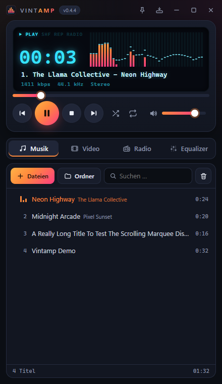
  &nbsp;
  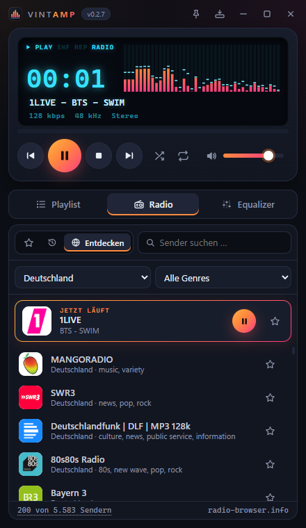
  &nbsp;
  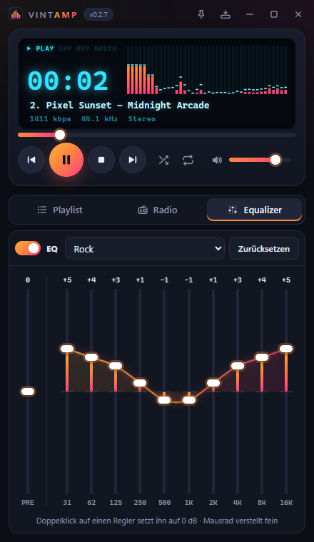

Screenshots show the German interface – Vintamp switches to English automatically on an English Windows.

**Maximized or full screen** – navigation on the left, content on the right, the player bar with its glowing display across the bottom:

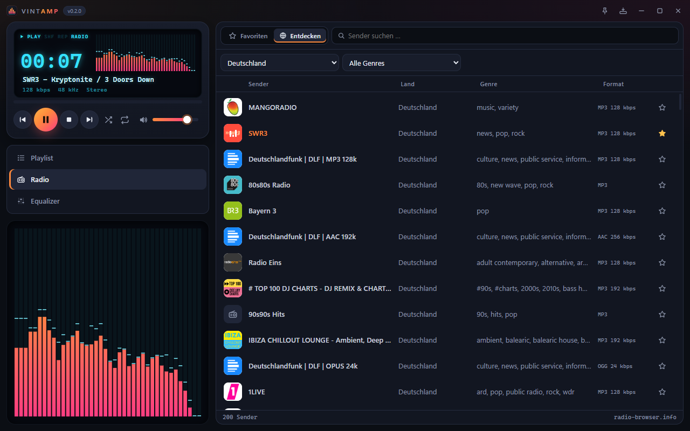

**DJ deck with auto mix** – two decks, mixer, effects and crossfader; press **AUTO** and Vintamp mixes your music list like a DJ: EQ and filter mixes, drop swap, echo out, loop roll, brake … to suit the mood, tempo, key and structure of the tracks:

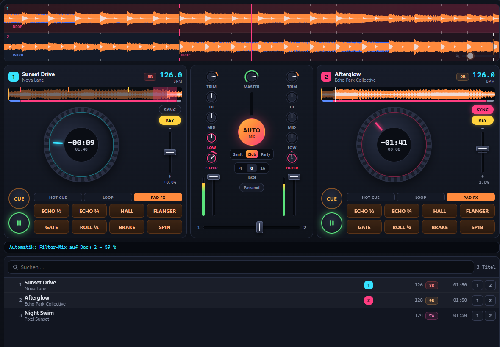

**Tempo and key** – Vintamp detects the BPM and key (Camelot) of every track; tracks that fit the playing one harmonically light up:

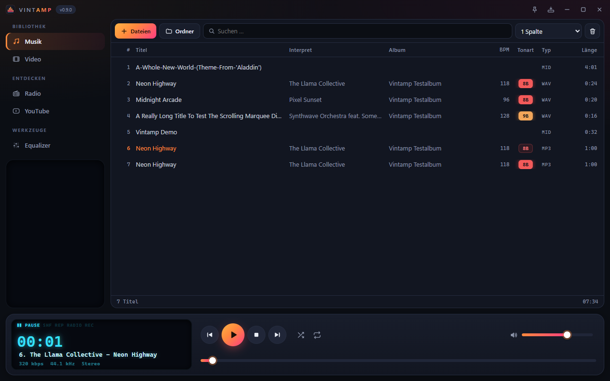

**Tag editor** – title, artist, album, BPM, key, cover … for one or many files; cue points and beat grids of DJ software are kept:

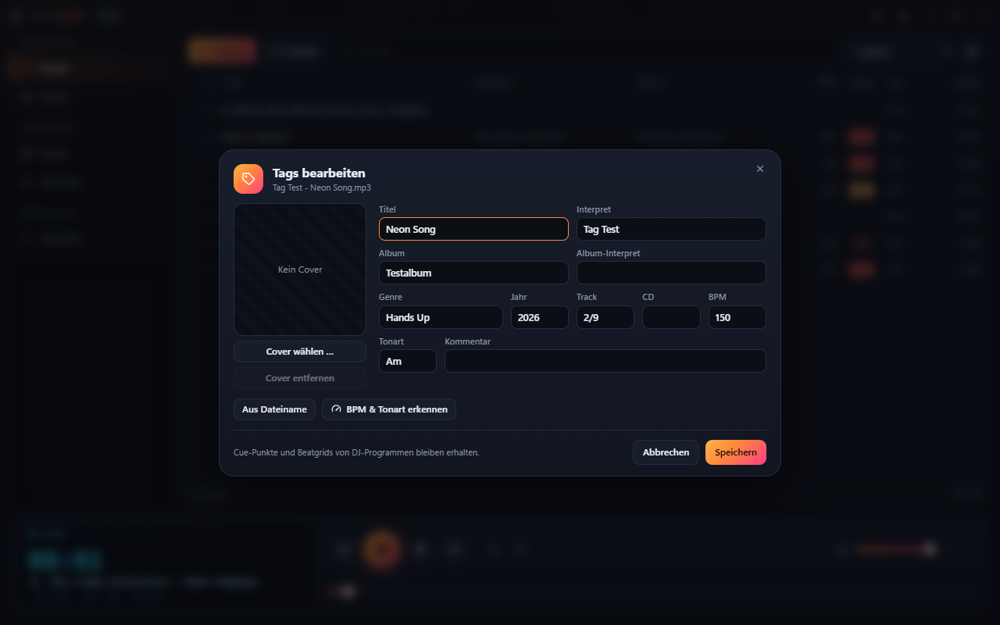

**YouTube Music** – “For you” suggestions, search, your own playlists and history:

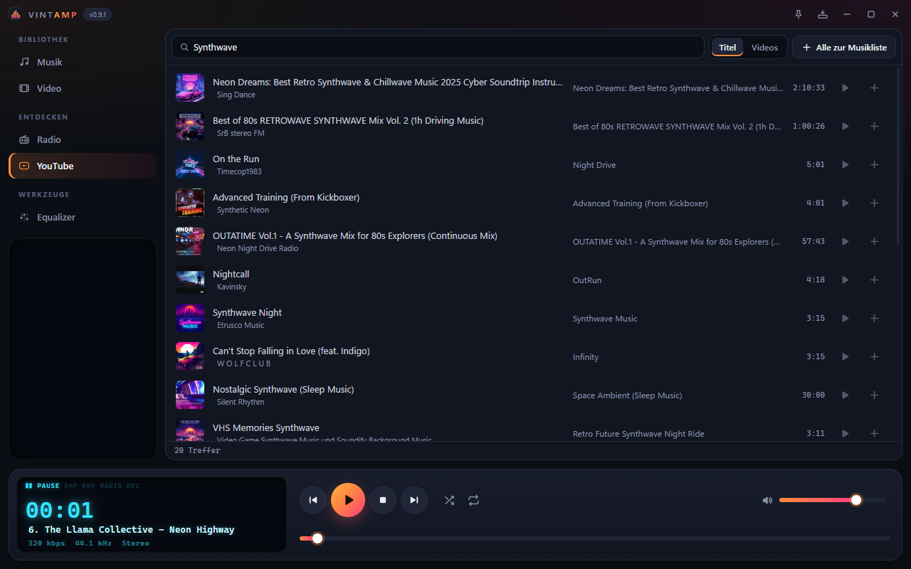

**Radio recording** – one click on ●, the broadcast is saved losslessly in one file; all recordings in their own section:

  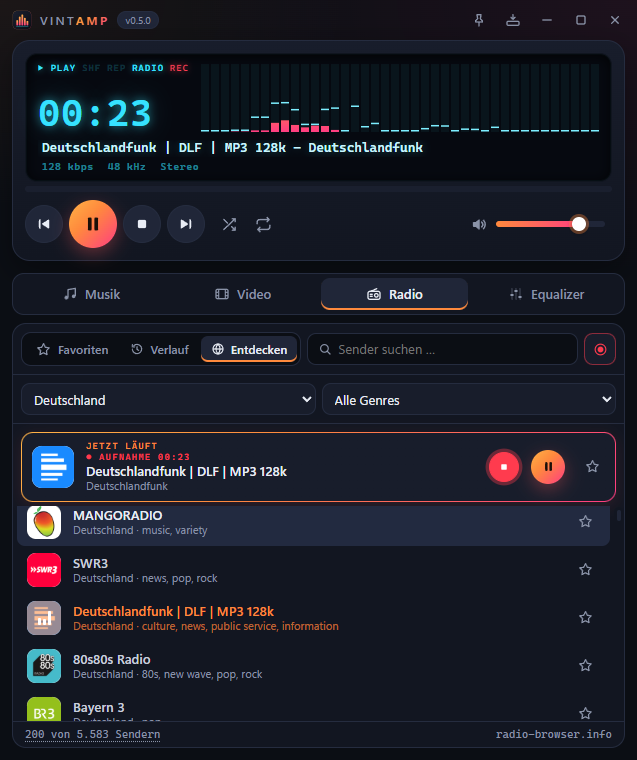
  &nbsp;
  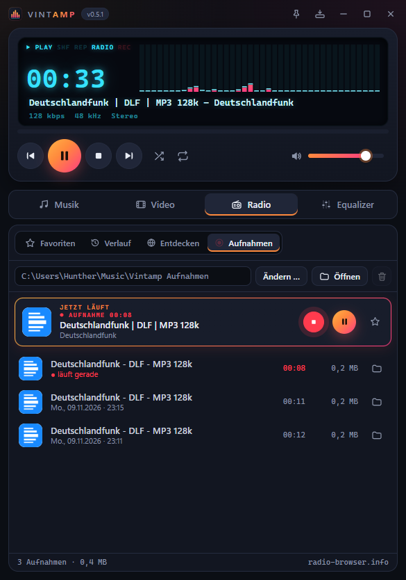

**Videos right in the window** – the control bar sits right below the picture, with subtitles, audio track selection and speed; click the picture to pause, double-click for full screen:

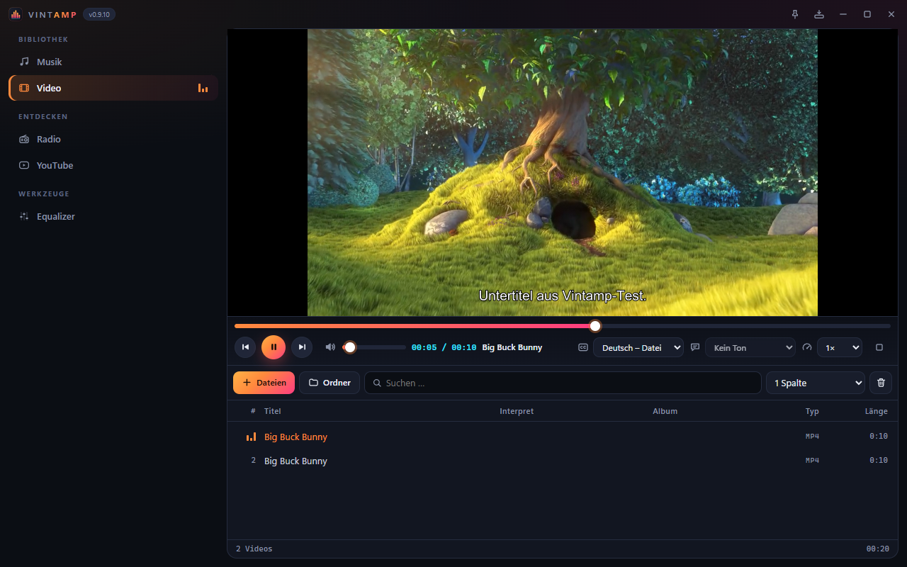 
Shown: “Big Buck Bunny” © Blender Foundation, <a href="https://creativecommons.org/licenses/by/3.0/">CC BY 3.0</a>

**Full screen like at the movies** – just the picture; move the mouse and the control bar fades in smoothly over the video and disappears again:

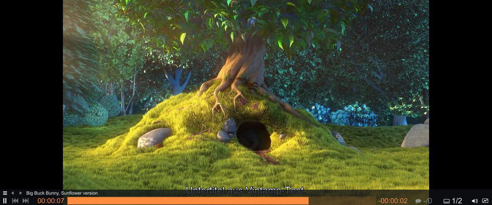

**Audio cutter** – right-click an audio file → “Cut …”: works like an audio editor, with a mixer and a graphic EQ:

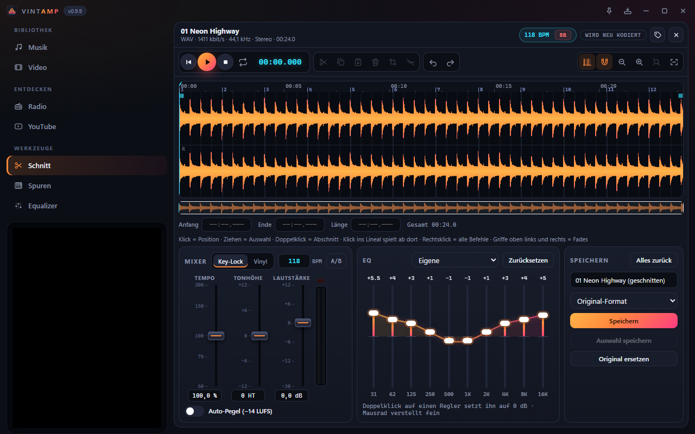

**MIDI with a track view** – every track with its instrument and notes, mute or solo each one:

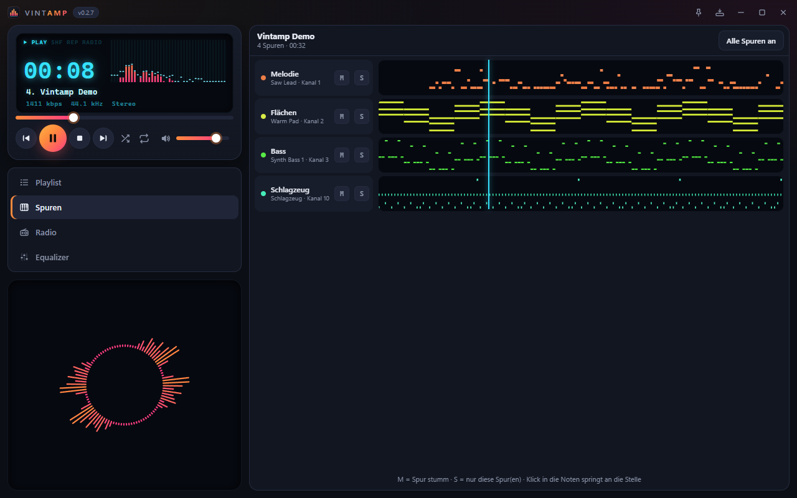

**16 visualizers in 4 color schemes** – a click switches to the next one, **right-click** opens the menu:

  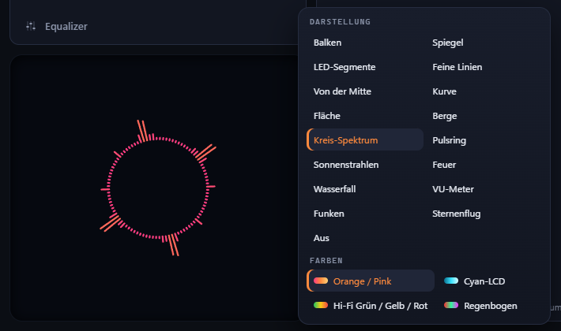

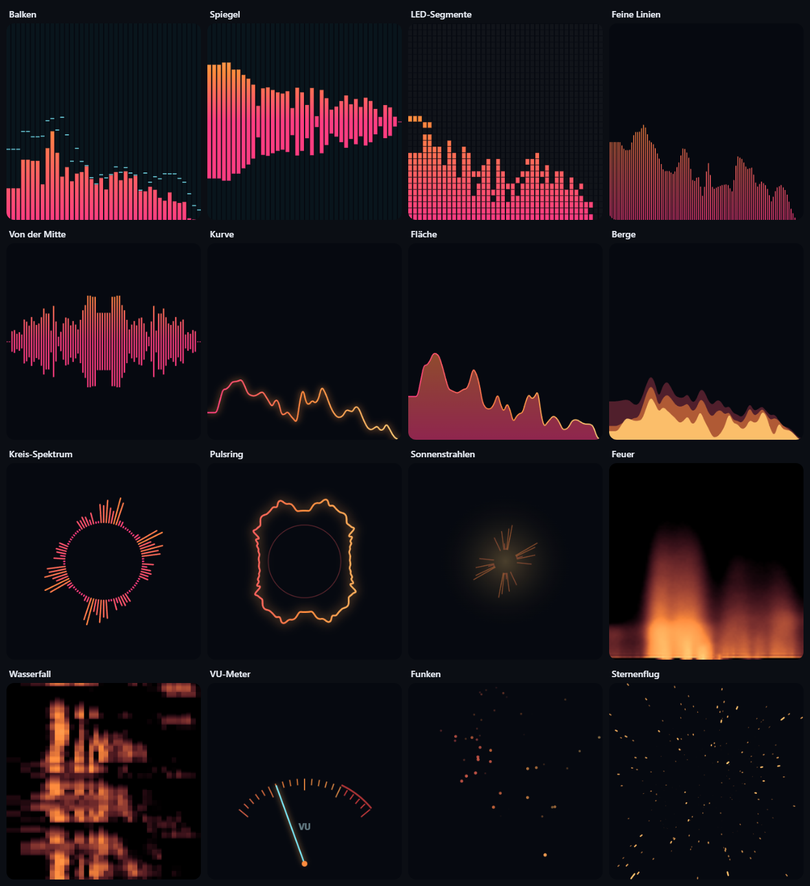

---

## What Vintamp can do today

**Playback**
- Plays practically every audio format: MP3, FLAC, OGG/Opus, AAC/M4A, WAV, WMA, APE and more
- Videos (MP4, MKV, WebM, AVI …) play right inside the Vintamp window in the “Video” tab – player
  on top, video list below; the control bar (seeking, previous/play/next, volume, time, subtitles,
  audio track, speed, full screen) sits right below the picture – the player bar at the bottom makes room;
  click the picture to pause, double-click or F
  toggles full screen, Esc to go back – full screen shows just the picture: move the mouse and the
  control bar (seeking, time, next/previous, subtitles, volume) fades in over it and out again
- Turn subtitles on and off or load a subtitle file (SRT, ASS, VTT …) – matching files next to the
  video are found automatically; choose the audio track or language (with readable names like
  “German – forced”); speed from 0.5× to 2× without chipmunk voices
- Display with glowing digits: playing time (click toggles elapsed / remaining),
  scrolling artist and title, bitrate, sample rate and channels

**Playlist**
- Separate tabs: **Music** for the music list, **Video** for the video list and player – next,
  previous and shuffle stay in the list that is currently playing
- Simply drag files or whole folders into the window
- Double-clicking a music file in Explorer plays it in the running Vintamp – no second window
- When the track changes, the current one moves to the middle – so you see what's coming next
- Title, artist, length, BPM and key are read from the tags
- **Tempo and key:** whatever the tags lack, Vintamp detects itself in the background (about half a second per
  track, each file only once) – BPM and key columns on the Camelot wheel; tracks that fit the playing one
  harmonically light up. Search also finds “128” or “8A”
- Sort by clicking a column header (title, artist, album, BPM, key, type, length)
- **Tag editor** (right-click → “Edit tags …”): title, artist, album, album artist, year, genre, track, disc, BPM,
  key, comment and cover – also for many files at once; “From file name” takes “Artist - Title”, “Detect BPM &
  key” fills tempo and key from the audio. Writing is lossless: cue points, beat grids and other data of DJ
  software are kept
- Search, multi-select (Ctrl/Shift), reorder with the mouse
- Remove one or several tracks from the list – Del, right-click or trash can (without a selection it clears the list)
- Shuffle, repeat (all or one track)
- Kept for the next start

**YouTube Music**
- Its own “YouTube” section with four views: **For you**, **Search**, **Playlists**, **History** – separate
  from the music list
- Search shows songs (album versions) and videos (live, remixes, covers …) together, with thumbnail, artist,
  album and length
- Click the picture or title to play; it then moves on to the next result automatically
- **Favourite songs** are always there: without folders of your own, “+” puts a song straight in there
- Your own playlists as folders (“Rock”, “Trance”, “Pop” …): sort songs in with “+”, numbered, reorder by
  dragging or Alt+↑/↓, play or shuffle, rename, delete
- **For you:** based on the songs you play and your playlists, Vintamp suggests similar music
  (“Because you played …”), “Shuffle” fetches new suggestions
- When a list ends, playback continues with similar songs, like on YouTube
- History of played songs; “Show similar songs” and “Copy link” in the right-click menu
- Nothing to set up: just search and play. The free helper yt-dlp, which translates YouTube addresses into a
  stream, is fetched by Vintamp itself with the first YouTube track (about 18 MB, once) and kept up to date
  in the background
- Only the audio is played as a stream – no music is downloaded or saved. Equalizer and visualizer work as
  with any other source

**DJ deck**
- Own **DJ** tab styled like a two-deck controller: jog wheel (turn to nudge or scrub), CUE, play, SYNC,
  KEY (keep the pitch), tempo fader ±8 % and 8 pads for **hot cues** and **loops** (½ to 32 beats)
- Mixer with TRIM, 3-band EQ (HI/MID/LOW, fully left = off), filter (left low-pass, right high-pass),
  channel faders with level meters, crossfader and master
- Two scrolling colour waveforms (bass/mids/highs) with beat grid, bars and phrases, plus an overview of the
  whole track per deck – click to jump there
- **Track structure:** Vintamp detects intro, build-up, drop, break and outro and colours them in the waveforms
- **PAD FX:** echo (½ or ¾ beat), reverb, flanger, gate, loop roll, brake and spinback – all on the beat; echo and
  reverb trail off, the loop roll jumps to where the track would have been without it
- Change the tempo without the Mickey Mouse effect (or like vinyl with KEY off); Vintamp detects tempo, beat
  grid and key itself and evens out the loudness of the tracks
- **AUTO:** mixes the tracks of the music list on its own like a DJ, picking a style for each transition:
  - **EQ mix** (highs, bass and mids swapped in stages) and **filter mix** – long and beat-matched
  - **Drop swap:** the new track runs its build-up under the old one and the cut lands right on its drop
  - **Echo out, loop roll** (1 → ½ → ¼ → ⅛ beat), **brake, spinback, reverb wash** – cut on the phrase
  - The mood **Smooth / Club / Party** decides which styles appear; tempo, key and structure have a say too,
    never the same style twice in a row. It prefers to leave at the start of the outro
  - Transition length 4, 8 or 16 bars; next track in list order or **“best fit”** (tempo, key)
- **Track understanding:** Vintamp analyses each track once – downbeat, phrases, structure, kick and groove,
  energy – and puts it into a style group (club, pop, calm). So techno is never followed by a ballad:
  anything unsuitable (style, tempo, energy jump) is skipped; only when nothing fits any more does the auto mix
  change style on purpose – or wind down, if you set it that way
- **Planned transitions:** in and out on phrases, no drop cut off; every option is rated (bars, harmony, energy,
  vocals, bass, structure) and run through a **test mix** in the background – level jumps, clipping and beats
  drifting apart show up beforehand
- **Tempo glides:** if the tempos don't quite match (e.g. 154 → 164 BPM), the playing track is slowly brought
  up to speed first – barely audible, pitch stays; the new one keeps its original tempo
- **Settings and log:** keep style, set flow (build up, hold, wind down), tempo limit and selection weighting;
  every transition is numbered in the log – with rating, warnings, reasons and rejected tracks
- While the deck plays, the normal player pauses – and vice versa
- For local audio files for now (MP3, FLAC, WAV, OGG, M4A …)

**Internet radio**
- More than 50,000 stations worldwide from the free radio-browser.info directory
- Search by name, country and genre – the most popular stations first, with station logos
- Favorites with one click on the star, history of recently played stations
- The current station stays pinned above the list, its current song also shows in the display
- Next/previous switches the station
- Vintamp remembers the last station – press play after restarting and it continues

**Radio recording**
- Record the current station with one click on ● – “REC” blinks in the display, the time runs along
- Lossless, exactly as broadcast (no re-encoding) – whether you're listening or not
- The broadcast is saved in one file, e.g. “Music\Vintamp Aufnahmen\1LIVE\1LIVE 2026-11-09 22-41.mp3” –
  cut it later with an audio editor
- Own “Recordings” section in the radio: all recordings with station, date, length and size – play,
  show in folder, move one or several to the Recycle Bin at once (Del, right-click or trash can)
- Choose where to save (default: Music\Vintamp Aufnahmen)
- If the connection drops briefly, Vintamp reconnects and keeps recording into the same file
- Vintamp also notes the station's track changes (CUE file) – the cutter shows them as markers

**Audio cutter**
- Right-click an audio file (music list or recording) → “Cut …” opens the “Cut” tab
- Works like an audio editor: click sets the position, drag selects, double-click selects the section,
  click the ruler to play from there; the selection snaps to markers and cuts
- Cut, copy, paste, delete, trim, silence – with Ctrl+X/C/V, Del, Ctrl+T, Ctrl+L or by right-click;
  unlimited undo
- Stereo waveform with zoom, overview and ruler; type start, end and length to the millisecond
- **Fades with the mouse:** drag the handles top left and right, pick the curve (linear, logarithmic,
  exponential, S-curve) by right-click
- **Mixer:** faders for tempo, pitch and volume with a level meter. “Key lock” changes tempo and pitch
  separately with Rubber Band R3 (studio algorithm), “Vinyl” links both like a turntable – free of
  any artifacts. A/B button to compare with the original, auto level (−14 LUFS)
- **EQ:** the same 10-band equalizer as in the “Equalizer” section – same sliders, same presets
  (Rock, Pop, Bass boost …), applied to the file when saving
- You hear everything right away in the preview, the selection also in a loop
- Save as a new file or in place of the original (the old one goes to the Recycle Bin) – MP3, FLAC, WAV, Ogg;
  tags and cover are kept
- **Lossless:** MP3/AAC that are only cut get copied frame by frame – no quality loss,
  an hour is saved in a fraction of a second
- **Radio recordings:** one click on a marker selects the whole song, the file name “Artist - Title”
  is already filled in; after cutting, Vintamp adjusts the markers

**MIDI**
- Play MIDI files (.mid, .midi, .kar) – with equalizer, seeking and visualizer like any other file
- The track view opens right away when a MIDI file starts: every track with its instrument and
  notes, click to jump to that position
- Mute or solo single tracks – Vintamp remixes and keeps playing seamlessly
- The sound library is downloaded once with the first MIDI file (31 MB) – or choose your own SoundFont

**Sound**
- 10-band equalizer with preamp – changes apply instantly, without clicks
- 12 presets (Rock, Pop, Jazz, Classical, Bass boost, Vocal, Headphones …)

**Visualizer**
- 16 styles: Bars, Mirror, LED segments, Fine lines, From the center, Curve, Area, Mountains,
  Circle spectrum, Pulse ring, Sunbeams, Fire, Waterfall, VU meter, Sparks, Starfield
- 4 color schemes: orange/pink, cyan LCD, hi-fi green/yellow/red, rainbow
- Click the visualizer to switch to the next style, **right-click** opens the menu
  with all styles and colors
- The display and the large visualizer remember their style separately
- The large visualizer fills the sidebar – centered behind it the cover of the current track (YouTube picture,
  station logo or the cover embedded in the file). The cover moves with the music: it pulses with the bass,
  glows in the visualizer's colors and the background brightens with the level
- While a video plays, the visualizers step aside – the picture comes first

**Usability**
- Wide (maximized or full screen, F11): sidebar with library, discover and tools plus a large visualizer on the
  left, content on the right, the player bar with its glowing display across the bottom
- Narrow: content on top, the player bar below, navigation as an icon bar at the very bottom – like a phone app
- Small level bars in the navigation show where the music is coming from (music, video, radio or YouTube)
- On wide screens, music, videos, stations and YouTube lists are shown in several columns side by side –
  automatically by window width or fixed at 1–6 columns
- Mini mode as a slim bar and “always on top”
- Remembers the window size and position (also “maximized” and mini mode) for the next start
- Keyboard media keys and classic shortcuts (Z X C V B)
- **English and German:** Vintamp follows the Windows language; switch it in the About dialog
  (click the version number) – instantly, without restarting. The installer comes in both languages, too

**Updates**
- Vintamp checks for new versions itself and installs them at the push of a button
- Every update is cryptographically signed – only what really comes from Hunther2K gets installed

---

## What's next

| | Feature | What it's about |
|---|---|---|
| 1 | **Spotify** | Control Spotify from Vintamp: search, playlists, current song in the display (via Spotify Connect, Premium required) |
| 2 | **Linux & macOS** | Vintamp on all three systems |

## Ideas for later

What else is possible – in no particular order:

- **Library:** music collection by artist, album and genre with covers, smart playlists
  (“recently added”, “not played for a long time”), find duplicates
- **Playlists:** save, load and exchange with other players (M3U, PLS)
- **Sound:** crossfade between tracks, equal loudness for all tracks (ReplayGain),
  change speed without chipmunk voices, repeat a section in a loop
- **Radio extras:** radio alarm clock, sleep timer, recording at a set time
- **Podcasts:** subscribe, new episodes automatically, continue where you left off
- **Tools:** convert files (e.g. FLAC → MP3), normalize the loudness of files
- **Comfort:** custom colors and themes, freely assignable shortcuts, Windows media overlay
  with cover, Last.fm scrobbling
- **Casting:** send music to Chromecast or DLNA devices on your home network
- **Portable version:** without installation, e.g. from a USB stick
- **More for the DJ deck:** analysis models for even more precise downbeat and vocal detection, sample pads to play on top (your own sounds too), headphone cueing on a
  second output, DJ controllers via MIDI, record your mix
- **Multitrack in the cutter:** select several files → each becomes its own track, move them,
  layer them and mix them down into one file

---

## Installation

1. [Download the latest version](https://github.com/hunther2k/vintamp-releases/releases/latest)
   (`Vintamp_x.y.z_x64-setup.exe`)
2. Run the installer – done. Vintamp appears in the Start menu.

**Requirements:** Windows 10 or 11, 64-bit. Linux and macOS will follow.

## Updates

Vintamp checks for a new version at startup and then shows a notice at the top.
Manually: click the version number at the top left → **Check for updates**.

## Wishes and bugs

Something doesn't work or you have an idea?
Feel free to open an [issue](https://github.com/hunther2k/vintamp-releases/issues) – in English or German.

## Thanks

- Playback: [mpv](https://mpv.io)
- Internet radio directory: [radio-browser.info](https://www.radio-browser.info)
- MIDI sounds: [GeneralUser GS](https://schristiancollins.com/generaluser.php) by S. Christian Collins
  (copy with license under [Releases](https://github.com/hunther2k/vintamp-releases/releases/tag/assets-soundfont))
