**🇩🇪 Deutsch** | [🇬🇧 English](README.en.md)

# Vintamp

**Der Player, wie er früher war – nur schöner.**
Klein, schnell, startet sofort und spielt so gut wie alles: Musik und Videos direkt im Fenster,
Internetradio (über 50.000 Sender) mit Aufnahme, Audio-Cutter, MIDI mit Spur-Ansicht, 10-Band-Equalizer, 16 Visualizer und
Mini-Modus – im modernen dunklen Design. Auf Deutsch und Englisch.

**[⬇ Neueste Version für Windows herunterladen](https://github.com/hunther2k/vintamp-releases/releases/latest)**

  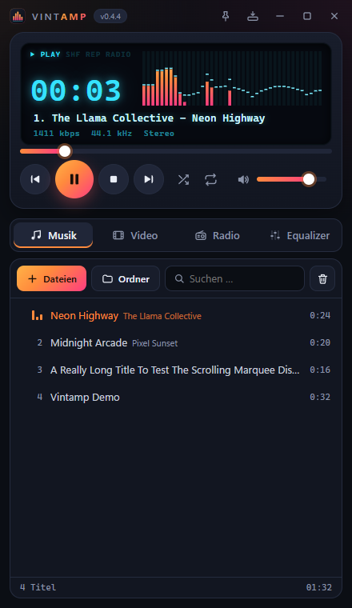
  &nbsp;
  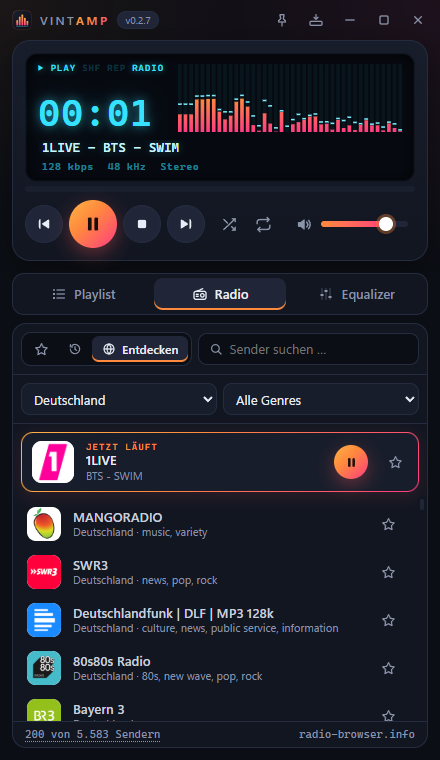
  &nbsp;
  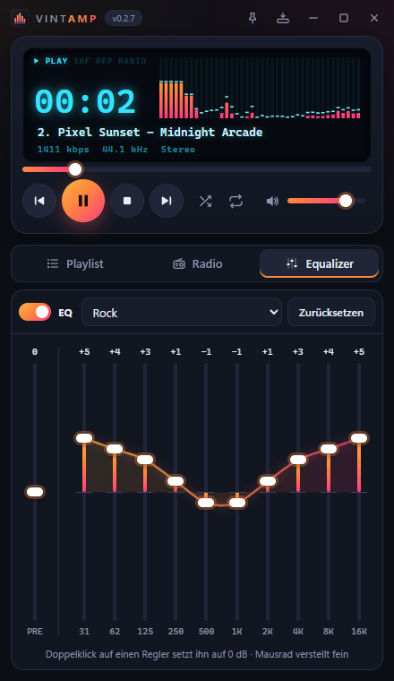

**Maximiert oder im Vollbild** – Player und großer Visualizer links, Senderliste mehrspaltig rechts:

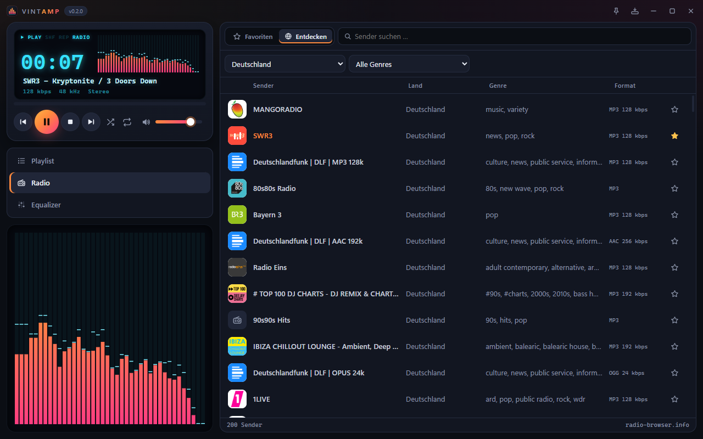

**Radio-Aufnahme** – ein Klick auf ●, die Sendung landet verlustfrei in einer Datei; alle Aufnahmen im eigenen Bereich:

  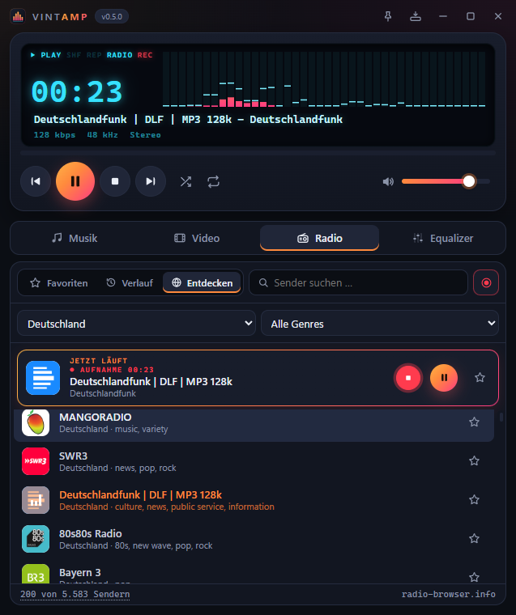
  &nbsp;
  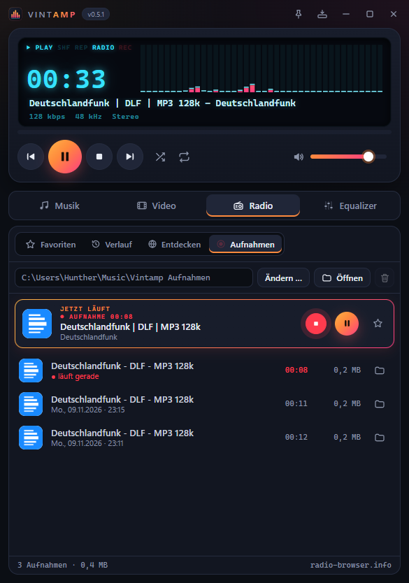

**Videos direkt im Fenster** – mit Untertiteln, Tonspur-Wahl und Geschwindigkeit; Klick ins Bild pausiert, Doppelklick schaltet auf Vollbild:

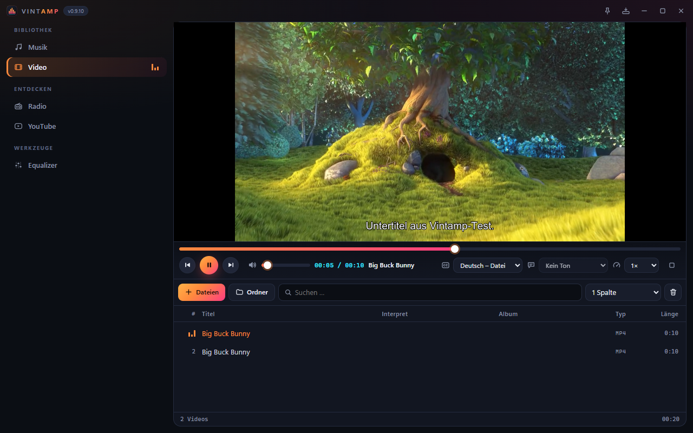 
Im Bild: „Big Buck Bunny“ © Blender Foundation, <a href="https://creativecommons.org/licenses/by/3.0/">CC BY 3.0</a>

**Vollbild wie im Kino** – nur das Bild; bewegst du die Maus, blendet die Bedienleiste weich über dem Video ein und verschwindet wieder:

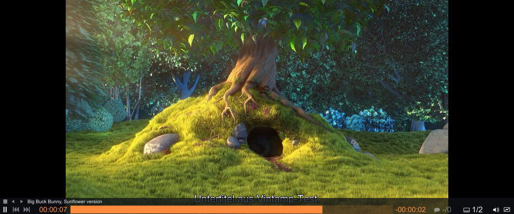

**Audio-Cutter** – Rechtsklick auf eine Audiodatei → „Schneiden …“: Wellenform, Titel aus Radio-Aufnahmen als Marken, verlustfrei speichern:

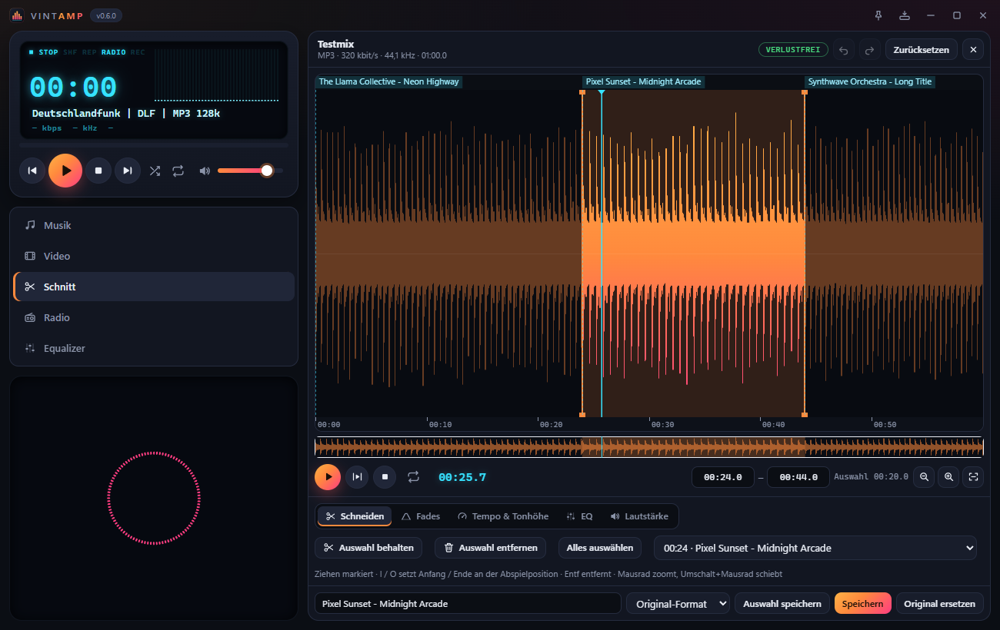

**MIDI mit Spur-Ansicht** – jede Spur mit Instrument und Noten, einzeln stumm oder solo:

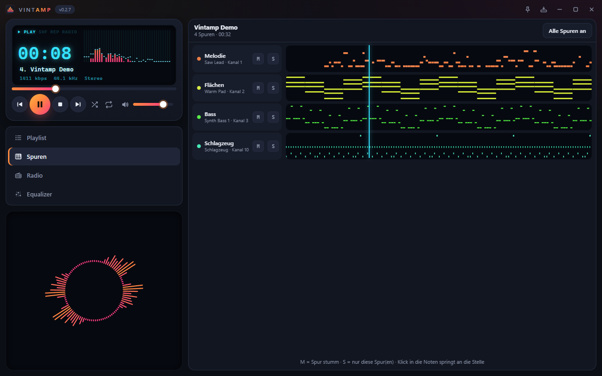

**16 Visualizer in 4 Farbschemata** – ein Klick schaltet weiter, **Rechtsklick** öffnet die Auswahl:

  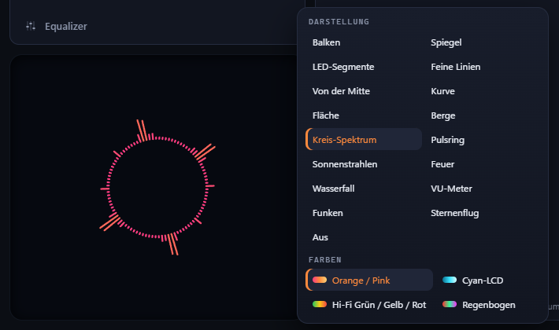

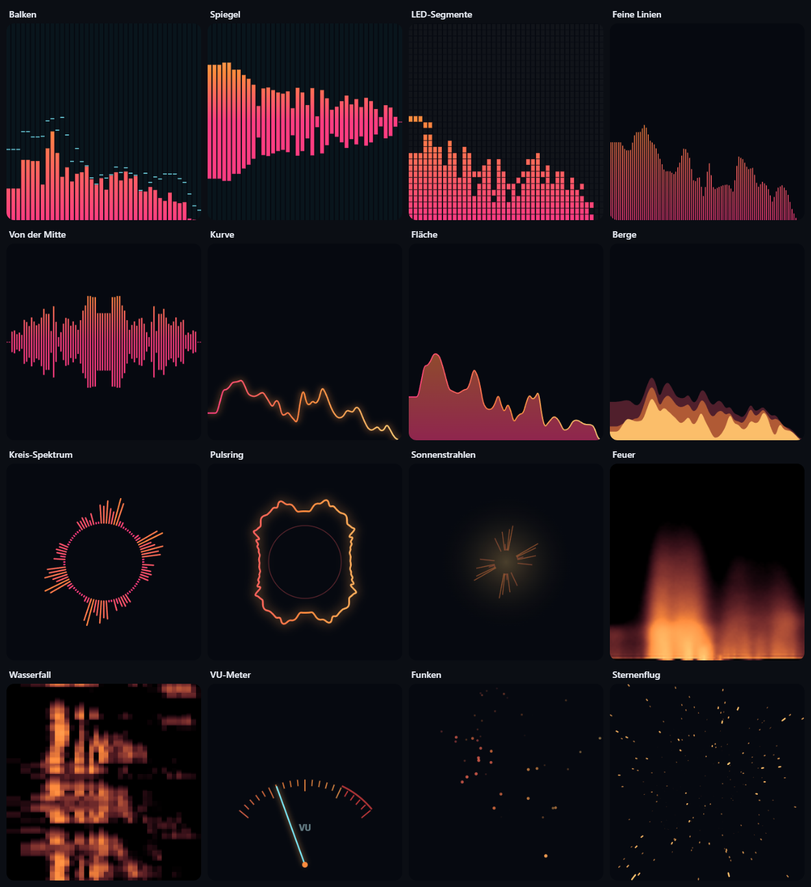

---

## Was Vintamp heute kann

**Abspielen**
- Spielt praktisch jedes Audioformat: MP3, FLAC, OGG/Opus, AAC/M4A, WAV, WMA, APE und mehr
- Videos (MP4, MKV, WebM, AVI …) laufen direkt im Vintamp-Fenster im Reiter „Video“ – oben der
  Player, darunter die Videoliste; mit
  schlanker Leiste (Zeit und Spulen oben im Player); Klick ins Bild pausiert, Doppelklick oder F
  schaltet Vollbild an und aus, Esc zurück – im Vollbild nur das Bild: bei Mausbewegung blendet die
  Bedienleiste (Spulen, Zeit, Weiter/Zurück, Untertitel, Lautstärke) weich darüber ein und wieder aus
- Untertitel ein- und ausschalten oder eine Untertiteldatei (SRT, ASS, VTT …) laden – passende
  Dateien neben dem Video findet Vintamp selbst; Tonspur bzw. Sprache wählen (mit verständlichen Namen wie „Deutsch – erzwungen“); Geschwindigkeit 0,5× bis 2×
  ohne Mickymaus-Stimme
- Display mit Leuchtziffern: Spielzeit (Klick wechselt zwischen verstrichen und verbleibend),
  Lauftext mit Interpret und Titel, Bitrate, Abtastrate und Kanäle

**Playlist**
- Eigene Reiter: **Musik** für die Musikliste, **Video** für Videoliste und Player – Weiter, Zurück
  und Zufall bleiben in der Liste, aus der gerade gespielt wird
- Dateien oder ganze Ordner einfach ins Fenster ziehen
- Doppelklick auf eine Musikdatei im Explorer spielt sie im laufenden Vintamp – kein zweites Fenster
- Beim Titelwechsel rückt der aktuelle Titel in die Mitte – man sieht, was als Nächstes kommt
- Titel, Interpret und Länge werden aus den Tags gelesen
- Suche, Mehrfachauswahl (Strg/Umschalt), Reihenfolge per Maus ändern
- Titel einzeln oder mehrere aus der Liste entfernen – Entf, Rechtsklick oder Mülleimer (ohne Auswahl leert er die Liste)
- Zufallswiedergabe, Wiederholen (alle oder einen Titel)
- Bleibt beim nächsten Start erhalten

**Internetradio**
- Über 50.000 Sender weltweit aus dem freien Verzeichnis radio-browser.info
- Suche nach Name, Land und Genre – die beliebtesten Sender zuerst, mit Senderlogo
- Favoriten mit einem Klick auf den Stern, Verlauf der zuletzt gehörten Sender
- Der laufende Sender steht fest über der Liste, sein aktueller Titel auch im Display
- Weiter/Zurück wechselt den Sender
- Vintamp merkt sich den letzten Sender – Play beim nächsten Start spielt ihn weiter

**Radio-Aufnahme**
- Den laufenden Sender mit einem Klick auf ● mitschneiden – „REC“ blinkt im Display, die Zeit läuft mit
- Verlustfrei, wie gesendet (ohne Umwandlung) – und unabhängig davon, ob du gerade zuhörst
- Die Sendung landet am Stück in einer Datei, z. B. „Musik\Vintamp Aufnahmen\1LIVE\1LIVE 2026-11-09 22-41.mp3“ –
  zerschneiden kannst du sie später mit einem Schnittprogramm
- Eigener Bereich „Aufnahmen“ im Radio: alle Aufnahmen mit Sender, Datum, Länge und Größe – abspielen,
  im Ordner zeigen, einzeln oder mehrere auf einmal in den Papierkorb (Entf, Rechtsklick oder Mülleimer)
- Speicherort frei wählbar (Standard: Musik\Vintamp Aufnahmen)
- Reißt die Verbindung kurz ab, verbindet Vintamp neu und nimmt in derselben Datei weiter auf
- Die Titelwechsel des Senders schreibt Vintamp nebenher mit (CUE-Datei) – im Cutter erscheinen sie als Marken

**Audio-Cutter**
- Rechtsklick auf eine Audiodatei (Musikliste oder Aufnahme) → „Schneiden …“ öffnet den Reiter „Schnitt“
- Große Wellenform mit Zoom und Übersicht; Bereich mit der Maus markieren, Anfang und Ende auch auf die
  Zehntelsekunde eintippen (oder I / O an der Abspielposition)
- Auswahl behalten (trimmen) oder herausschneiden – beliebig oft, mit Rückgängig und Wiederholen
- Ein- und Ausblenden, Tempo 0,5–2× ohne Mickymaus-Stimme, Tonhöhe ±12 Halbtöne ohne Tempoänderung,
  10-Band-EQ mit Voreinstellungen, Lautstärke und „alles gleich laut“ (−14 LUFS)
- Alles vorhören, die Auswahl auch in Schleife
- Speichern als neue Datei oder anstelle des Originals (das alte wandert in den Papierkorb) – MP3, FLAC, WAV, Ogg;
  Tags und Cover werden übernommen
- **Verlustfrei:** Nur geschnittene MP3/AAC werden rahmengenau kopiert – keine Qualitätsverluste,
  eine Stunde ist in Sekundenbruchteilen gespeichert
- **Radio-Aufnahmen:** Ein Klick auf eine Marke wählt den ganzen Song, der Dateiname „Interpret - Titel“
  ist schon ausgefüllt; nach dem Schneiden passt Vintamp die Marken an

**MIDI**
- MIDI-Dateien (.mid, .midi, .kar) abspielen – mit Equalizer, Spulen und Visualizer wie jede andere Datei
- Spur-Ansicht öffnet sich beim Start einer MIDI direkt: jede Spur mit Instrument und ihren Noten,
  Klick springt an die Stelle
- Einzelne Spuren stumm oder solo schalten – Vintamp mischt neu und spielt nahtlos weiter
- Die Klangbibliothek wird beim ersten MIDI einmalig geladen (31 MB) – oder eigene SoundFont wählen

**Klang**
- 10-Band-Equalizer mit Vorverstärker – Änderungen wirken sofort, ohne Knacken
- 12 Voreinstellungen (Rock, Pop, Jazz, Klassik, Bass-Boost, Stimme, Kopfhörer …)

**Visualizer**
- 16 Darstellungen: Balken, Spiegel, LED-Segmente, Feine Linien, Von der Mitte, Kurve, Fläche,
  Berge, Kreis-Spektrum, Pulsring, Sonnenstrahlen, Feuer, Wasserfall, VU-Meter, Funken, Sternenflug
- 4 Farbschemata: Orange/Pink, Cyan-LCD, Hi-Fi Grün/Gelb/Rot, Regenbogen
- Klick auf den Visualizer schaltet zur nächsten Darstellung, **Rechtsklick** öffnet das Auswahlmenü
  mit allen Darstellungen und Farben
- Display und großer Visualizer merken sich ihre Darstellung getrennt
- Während ein Video läuft, treten die Visualizer zurück – das Bild hat Vorrang

**Bedienung**
- Maximiert oder im Vollbild (F11) zweispaltig: Player und großer Visualizer links,
  Playlist mit Spalten (Titel, Interpret, Album, Typ, Länge) bzw. Senderliste rechts
- Auf breiten Bildschirmen stehen Playlist und Sender mehrspaltig nebeneinander –
  automatisch nach Fensterbreite oder fest 1–6 Spalten
- Mini-Modus als schmale Leiste und „Immer im Vordergrund“
- Medientasten der Tastatur und klassische Tastenkürzel (Z X C V B)
- **Deutsch und Englisch:** Vintamp folgt der Windows-Sprache; umschaltbar im Über-Dialog
  (Klick auf die Versionsnummer) – sofort, ohne Neustart. Den Installer gibt es ebenfalls in beiden Sprachen

**Updates**
- Vintamp sucht selbst nach neuen Versionen und installiert sie auf Knopfdruck
- Jedes Update ist kryptografisch signiert – installiert wird nur, was wirklich von Hunther2K stammt

---

## Was als Nächstes kommt

| | Funktion | Darum geht's |
|---|---|---|
| 1 | **Tag-Editor** | Titel, Interpret, Album, Jahr, Genre, Tracknummer und Cover bearbeiten – auch für viele Dateien auf einmal, Tags aus dem Dateinamen übernehmen |
| 2 | **YouTube Music** | Deine YouTube-Music-Bibliothek in Vintamp nutzen |
| 3 | **Spotify** | Spotify aus Vintamp steuern: Suche, Playlists, aktueller Titel im Display (über Spotify Connect, Premium nötig) |
| 4 | **Linux & macOS** | Vintamp auf allen drei Systemen |

## Ideen für später

Was noch denkbar ist – ohne feste Reihenfolge:

- **Bibliothek:** Musiksammlung nach Interpret, Album und Genre mit Covern, intelligente Playlists
  („zuletzt hinzugefügt“, „lange nicht gehört“), doppelte Titel finden
- **Playlists:** speichern, laden und mit anderen Playern austauschen (M3U, PLS)
- **Klang:** Überblenden zwischen Titeln, gleiche Lautstärke für alle Titel (ReplayGain),
  Geschwindigkeit ändern ohne Mickymaus-Stimme, Abschnitt in Schleife wiederholen
- **Radio-Extras:** Radiowecker, Schlummer-Timer, Aufnahme zu einer bestimmten Uhrzeit
- **Podcasts:** abonnieren, neue Folgen automatisch, Weiterhören an der letzten Stelle
- **Werkzeuge:** Dateien umwandeln (z. B. FLAC → MP3), Lautstärke von Dateien angleichen
- **Komfort:** eigene Farben und Designs, Tastenkürzel frei belegen, Anzeige im
  Windows-Medienfenster mit Cover, Last.fm-Scrobbling
- **Weitergeben:** Musik an Chromecast- oder DLNA-Geräte im Heimnetz schicken
- **Portable Version:** ohne Installation, z. B. vom USB-Stick
- **Auto-DJ:** Playlist vorbereiten – Vintamp übernimmt die Übergänge wie ein DJ: Tempo angleichen,
  im Takt überblenden, Bässe sauber tauschen, verschiedene Übergangsstile
- **DJ-Modus:** selbst auflegen mit zwei Decks, Mischpult mit Crossfader, Sync, Pitch, EQ und Filter
  je Deck, Effekte, Sample-Pads zum Drauflegen und Wellenform-Anzeige
- **Mehrspur im Cutter:** mehrere Dateien markieren → jede wird eine eigene Spur, verschieben,
  übereinanderlegen und zu einer Datei zusammenmischen

---

## Installieren

1. [Neueste Version herunterladen](https://github.com/hunther2k/vintamp-releases/releases/latest)
   (`Vintamp_x.y.z_x64-setup.exe`)
2. Installer starten – fertig. Vintamp landet im Startmenü.

**Voraussetzung:** Windows 10 oder 11, 64 Bit. Linux und macOS folgen.

## Updates

Vintamp prüft beim Start, ob es eine neue Version gibt, und zeigt dann oben einen Hinweis.
Von Hand: Klick auf die Versionsnummer oben links → **Nach Updates suchen**.

## Wünsche und Fehler

Etwas funktioniert nicht oder du hast eine Idee?
Schreib es gern als [Issue](https://github.com/hunther2k/vintamp-releases/issues).

## Danke

- Wiedergabe: [mpv](https://mpv.io)
- Internetradio-Verzeichnis: [radio-browser.info](https://www.radio-browser.info)
- MIDI-Klänge: [GeneralUser GS](https://schristiancollins.com/generaluser.php) von S. Christian Collins
  (Kopie mit Lizenz unter [Releases](https://github.com/hunther2k/vintamp-releases/releases/tag/assets-soundfont))
